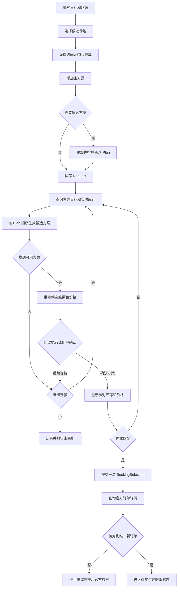

# 订场流程设计

状态：久事单平台已接入，真实账号与付款验收进行中

这份文档定义传统表单版订场体验。自然语言解析和 AI 入口放到后续适配层，底层 Request、Plan、库存和订单流程保持确定性。

## 产品定位

当前模块对应一个携程式订场引擎。用户先填写可接受的条件，程序查询实时库存，生成有优先级的候选方案，再把其中一个方案转成具体订单并提交。

订场流程属于 Booking Agent 的确定性内核，负责以下工作：

- 读取场馆和场次库存
- 按日期、时间、场地、数量和预算筛选
- 生成并排序候选方案
- 在提交前重新核对库存和价格
- 创建订单并核对官方订单
- 跟踪待支付和失败状态

## 核心概念

### Request

一次用户订场意图。一个 Request 包含公共条件和按优先级排列的多个 Plan。

Request 的公共条件包括：

- 运动和场馆
- 目标日期
- 候选场地集合
- 可接受时间范围
- 总预算
- 包场人
- 方案优先级

### Plan

一套完整的订场策略。Plan 之间有明确顺序，程序只提交第一个成功的 Plan。

Plan 至少需要描述：

- 方案类型
- 需要的场次数量
- 是否要求连续
- 是否要求同一片场地
- 是否允许跨场地
- 时间范围
- 价格上限
- 场地和时间优先级

推荐的方案类型包括：

| 类型 | 含义 |
| --- | --- |
| `single_slot` | 抢到一个符合条件的官方场次即可 |
| `contiguous_bundle` | 抢同一片场地上连续的多个官方场次 |
| `split_bundle` | 抢多个不连续场次，作为一个组合方案处理 |

连续两段和不连续两段属于不同 Plan。它们不能被展平成一个没有语义的场次列表。

### CandidateSlot

官方实时库存中的一个场次。CandidateSlot 只有在重新查询后才具有提交资格。

### BookingSelection

程序根据某个 Plan 选出的具体场次集合。它是提交订单前的最后结果，必须通过库存、价格、日期和场地校验。

### BookingOrder

提交接口返回并经过官方订单详情核对的订单。只有 BookingOrder 创建成功后，Request 才进入待支付状态。

## 主流程



## 用户操作流程

第一步选择公共条件。用户选择运动、场馆、日期、候选场地、时间范围、包场人和总预算。

第二步配置方案。用户设置主方案，并按需要添加备选方案。每个方案都明确说明场次数量、连续性和同场要求。

第三步查看候选结果。程序展示方案名称、具体场地、时间、单段价格、总价和匹配原因。

第四步开始守候。程序在官方开放时间附近查询库存，查询频率受固定范围限制。库存开放后进入较快的检查阶段。

第五步提交订单。程序只提交一个已经通过二次核对的 BookingSelection。提交结果不明确时只查询官方订单，不重复发送。

第六步付款跟踪。订单核对成功后提示用户使用下单账号付款，并显示待支付状态。

## 示例

用户希望在 11:00–15:00 之间打球，接受室外 3 号场和室外 4 号场。

```text
Request
  日期             2026-11-22
  场馆             徐家汇体育公园
  候选场地         室外3号场、室外4号场
  时间范围         11:00-15:00
  总预算           450元

Plan 1  主方案
  类型             contiguous_bundle
  数量             2段
  约束             同一片场地、连续时段
  优先级           较早时间优先

Plan 2  备选方案
  类型             single_slot
  数量             1段
  约束             任一候选场地、任一符合条件时段

Plan 3  备选方案
  类型             split_bundle
  数量             2段
  约束             同一天，可以不连续
```

程序先尝试 Plan 1。Plan 1 没有匹配库存时，进入 Plan 2。Plan 2 成功后停止，不继续提交 Plan 3。

如果用户希望连续两小时和不连续的两段都能接受，它们仍然属于同一个 Request 的不同 Plan。

如果用户希望两个方案都分别下单，则应创建两个 Request，避免一次订场意图产生多个订单。

## 规则边界

- 候选场地可以多选。多选表示可接受范围，不代表所有场地都必须下单。
- 多个 Plan 按优先级执行，成功一个后停止提交。
- 同场连续是 `contiguous_bundle` 的约束，不是所有 Request 的全局约束。
- 两个不连续场次是否允许跨场地，由 `split_bundle` 的配置决定。
- 只有实时库存中的具体场次才能进入 BookingSelection。
- 提交前必须重新查询库存和价格。
- 提交结果不明确时不得自动重试提交。
- 跨场地组合订单需要先验证官方接口的实际接受范围。

## 当前实现映射

- `SessionScreen` 和 `UserInfoPanel` 负责连接微信中的久事、只读验证和包场人选择，高级选项支持会话导入。`wechat_session.py` 在后台读取带有久事 AppID 与域名标记的小程序进程，候选会话经官方验证后才保存。
- `GroundSelectScreen` 负责读取官方场次、显示开放状态并保留候选勾选。
- `booking_flow` 定义 `BookingRequest`、`Plan`、`CandidateSlot`，按方案顺序匹配库存与预算。
- `GroundInfoPanel` 负责候选预览、确认、立即或定时执行和停止任务。
- `orders.submit_selection` 负责提交前已有订单检查、库存复查、单次提交及唯一新订单核对。
- `orders.track_payment` 负责官方付款状态、期限和提醒重试。
- `OrdersScreen` 提供重启后继续核对与付款跟踪入口。
- `phone_notify` 负责 Server酱设置、Windows 用户加密和微信提醒发送。

## 后续实现顺序

1. 继续完善凭证获取体验并完成新会话真实登录验收。
2. 使用本人明确选择的目标验收真实订单、手机付款及通知送达。
3. 验证官方跨场地组合的接受范围。
4. 久事流程稳定后再评估其他平台接入。
