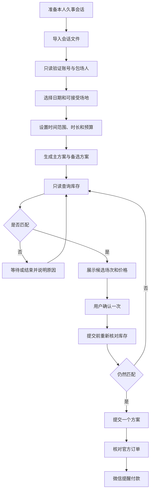

# 久事单平台第一阶段流程

当前只维护久事体育，先把一个平台的传统订场体验做完整，再抽象其他平台适配器。

## 用户流程

## 关键交互

- 登录页只显示一个入口“导入本人会话文件”，导入后先验证账号，不让用户直接进入选场。
- 选场页先选可接受范围，再配置方案。多选场地表示可以接受其中一个，不表示需要同时订下全部场地。
- 连续两小时、不连续两场和单场分别属于不同方案。主方案成功后停止提交其他方案。
- 查询结果要显示场馆、场号、日期、时段、价格和匹配原因。用户确认前不创建订单。
- 提交结果不明确时只查询官方订单，不重复提交。
- 订单核对成功后通过现有 Server酱通道提醒微信，提醒内容只包含场次、金额、付款截止时间和付款入口说明。

## 安全边界

当前主流程不修改 Windows 系统代理，不安装证书，不拦截微信流量，不请求管理员权限。会话由用户从官方客户端导出后主动导入，程序只读取久事域名请求并执行只读验证。

## 实现顺序

1. 把现有登录页改成会话导入和只读验证。
2. 将现有选场数据映射为 `Request`、`Plan`、`CandidateSlot` 和 `BookingSelection`。
3. 先完成 `single_slot` 和 `contiguous_bundle`，并保留主方案与备选方案排序。
4. 接入候选结果预览、二次库存核对和单次提交。
5. 接通 Server酱微信提醒和付款跟踪。
6. 久事流程稳定后，再按相同适配器接口接入韵动吧等平台。
